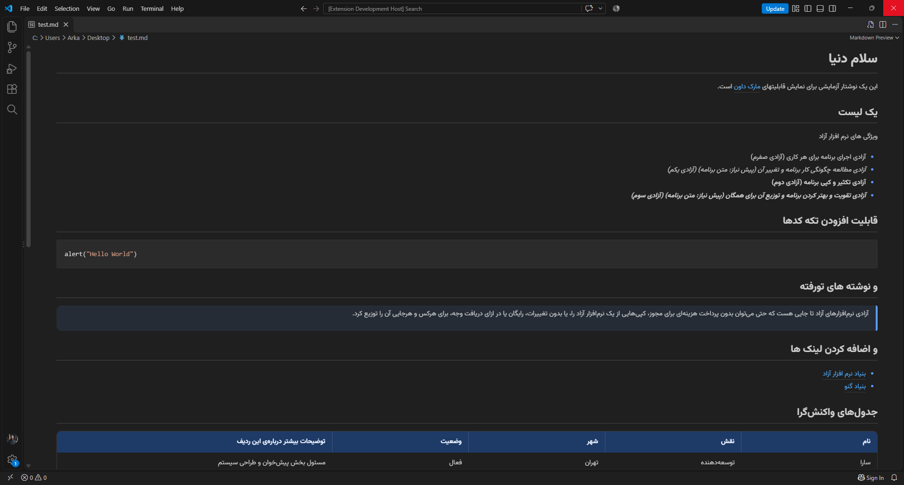
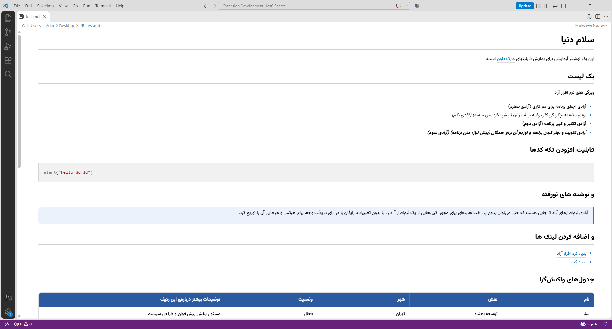

# RTL Markdown Preview برای VS Code

پیش‌نمایش مارک‌داونِ خود VS Code برای فارسی، عربی و عبری آنقدرها دوست‌داشتنی نیست: همه‌چیز می‌چسبد به چپ، فونت مناسبی ندارد و جدول‌های پهن از قاب بیرون می‌زنند. این اکستنشن همان پیش‌نمایش داخلی را درست می‌کند، بدون اینکه پنجره‌ی جداگانه‌ای اضافه کند.

نسخه‌ی تحت وب: [isalehgholami.github.io/rtl-md-persian](https://isalehgholami.github.io/rtl-md-persian)





رنگ‌ها از تم VS Code پیروی می‌کنند، پس هر دو حالت روشن و تیره پشتیبانی می‌شود.

## چه کارهایی می‌کند

- جهت هر بلوک (پاراگراف، لیست، نقل‌قول، جدول) را **خودکار** از روی اولین حرفش تشخیص می‌دهد. پس یک فایل با متن فارسی و انگلیسی مخلوط هم درست دیده می‌شود.
- فونت [وزیرمتن](https://github.com/rastikerdar/vazirmatn)
- جدول‌ها در عرض کم داخل قاب خودشان اسکرول می‌خورند. هدر جدول آبی است و با تم تیره‌ی VS Code هم هماهنگ می‌شود.
- کد همیشه چپ‌به‌راست می‌ماند.
- یک دکمه در نوار وضعیت (پایین پنجره) که بین «خودکار»، «RTL» و «LTR» جابه‌جا می‌شود.

## استفاده

یک فایل `.md` را باز کن و پیش‌نمایش را همان‌طور که همیشه باز می‌کنی ببین (`Ctrl+Shift+V` یا `Ctrl+K V`). تغییر جهت از نوار وضعیت یا از Command Palette با دستور **RTL Markdown: تغییر جهت پیش‌نمایش** است.

تنظیم:

| تنظیم | مقدار پیش‌فرض | توضیح |
|---|---|---|
| `rtlMd.direction` | `auto` | یکی از `auto`، `rtl` یا `ltr` |

## نصب

هنوز در Marketplace منتشر نشده. برای نصب دستی، ریپو را بگیر و یک بسته‌ی `.vsix` بساز:

```bash
npx @vscode/vsce package
code --install-extension rtl-md-vscode-0.1.0.vsix
```

## توسعه و تست

پروژه را در VS Code باز کن و برای تست از **Run Without Debugging** (`Ctrl+F5`) استفاده کن. یا از ترمینال:

```bash
code --new-window --disable-extensions --extensionDevelopmentPath=. نمونه.md
```

با `F5` (همراه دیباگر) ممکن است پنجره‌ی تست بعد از ریلود کرش کند. این مشکل از دیباگر نود است، نه از اکستنشن. بعد از هر تغییر در کد، پنجره‌ی تست را ببند و دوباره اجرا کن.

## نکته‌ها

- فونت از CDN جیدلیور لود می‌شود. بدون اینترنت، فونت پیش‌فرض VS Code استفاده می‌شود و بقیه‌چیز مثل قبل کار می‌کند.
- ویرایشگر متن خود VS Code از جهت راست‌به‌چپ پشتیبانی نمی‌کند. این اکستنشن فقط پیش‌نمایش را عوض می‌کند.

## مشارکت

ایراد دیدی یا ایده‌ای داری؟ یک Issue یا Pull Request باز کن.

## سازنده

[@iSalehGholami](https://github.com/iSalehGholami). نسخه‌ی وب: [rtl-md-persian](https://github.com/isalehgholami/rtl-md-persian)

## لایسنس

[MIT](LICENSE)
